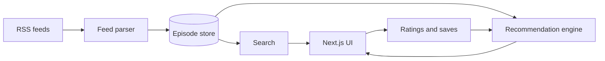

# Podcast Discovery Engine

_(working title, rename once you land on something better)_

> A Discover Weekly style recommendation engine for the podcasts you already subscribe to, built with Next.js, TypeScript, and a content based ranking system you fully control.

## Status

Planning stage. No code exists yet. This document is the spec to build against, not a description of something already shipped. Keep it updated as decisions change, it should describe the real thing once you start building, not just the first idea.

## Table of contents

1. [What this is](#1-what-this-is)
2. [The problem it solves](#2-the-problem-it-solves)
3. [How it works, in plain terms](#3-how-it-works-in-plain-terms)
4. [Architecture](#4-architecture)
5. [Core concepts explained](#5-core-concepts-explained)
6. [Tech stack and reasoning](#6-tech-stack-and-reasoning)
7. [Data model](#7-data-model)
8. [Project structure](#8-project-structure)
9. [Setup](#9-setup)
10. [Environment variables](#10-environment-variables)
11. [Running locally](#11-running-locally)
12. [Roadmap](#12-roadmap)
13. [Known limitations](#13-known-limitations)
14. [Notes to self](#14-notes-to-self)
15. [License](#15-license)

## 1. What this is

A single user web app that pulls episodes from a list of podcast RSS feeds you choose, lets you search and filter them, and ranks unheard episodes by how closely they match episodes you have already rated highly. Built on Next.js with TypeScript, it stores episode data in one place and starts simple with localStorage before optionally moving to Firestore for persistence across sessions and devices.

It is not a podcast player. Playback stays with the audio URL already present in each episode's RSS entry, opened in the browser or handed off to whatever app you already use to listen.

## 2. The problem it solves

Podcast apps are built for playback and new episode notifications, not for digging through the back catalog of shows you already follow. If a podcast has 400 episodes and you started listening 30 episodes ago, there is no good way to ask "which of the other 370 match what I already like" without scrolling through titles one at a time. This tool treats every episode across every feed you add as one searchable, rankable pool, and uses your own ratings to work out what else in that pool is worth your time.

## 3. How it works, in plain terms

Four moving parts, in order:

1. **Feeds in, episodes out.** You give the app a list of RSS feed URLs. It fetches and parses each one into a flat list of episodes: title, description, audio link, publish date, duration, category tags.
2. **Tagging.** Each episode inherits category tags from its feed's own metadata, with manual overrides where a feed's tags are missing or too broad.
3. **You rate what you listen to.** A 1 to 5 rating after finishing an episode, or a thumbs up and down if you want less friction.
4. **It learns your taste and ranks accordingly.** Your ratings build a lightweight taste profile. Every unheard episode gets scored against that profile, and the highest scoring ones surface first.

Think of it as a personal shopper who remembers which shirts you kept and which you returned, then goes looking for shirts cut from similar cloth. Swap shirts for episodes and cloth for tags, and that is the whole recommendation engine. Section 5.3 walks through the actual math.

## 4. Architecture



- **RSS feeds**: the podcasts you subscribe to, unchanged, hosted wherever they already live.
- **Feed parser**: a scheduled job that fetches each feed and converts its XML into episode objects. A Vercel cron route is the simplest option since you are already deploying there. If you would rather reuse the cron triggered sync worker pattern from your other side project, a Cloudflare Worker on a schedule does the same job just as well.
- **Episode store**: the single source of truth for every episode across every feed. Starts as localStorage, moves to Firestore once you want data to survive a cleared cache.
- **Search**: fuzzy text search over title and description, run client side against the episode store.
- **Recommendation engine**: scores unheard episodes against your taste profile using cosine similarity, details in 5.3.
- **Next.js UI**: renders search results and ranked recommendations, and captures your ratings and saves.
- **Ratings and saves feed back into the recommendation engine**: every new rating updates your taste profile, so ranking quality improves the more you use the app.

## 5. Core concepts explained

### 5.1 RSS parsing

Every podcast host publishes an RSS feed: an XML document with one `<item>` per episode, carrying title, description, publish date, audio file URL, and duration. Use the `rss-parser` npm package to turn each feed's XML into a plain JS array of episode objects, rather than hand rolling an XML parser.

Run this on a schedule instead of on every page load. Parsing 10 feeds live on every visit is slow and feeds do not change every second, so a periodic sync job, hourly or daily, that writes results to the episode store is the right shape.

### 5.2 Tagging strategy

Two tag sources, in priority order:

1. **iTunes category metadata.** Most podcast RSS feeds carry `<itunes:category text="Technology">` tags, which `rss-parser` extracts automatically. This covers the majority of feeds with zero manual work.
2. **Manual overrides.** Set in `data/feeds.json` for feeds whose categories are missing or too broad, or when you want finer grained tags than the feed provides, for example splitting a generic "News" category into "tech-news" and "politics".

Episode level tags, as opposed to feed level tags, are a later addition. Skip them until feed level tags feel too coarse to be useful, which will likely be a while.

### 5.3 The recommendation engine: cosine similarity

This is content based filtering: recommendations come from comparing episode tags to your own rating history, not from what other users liked, because there are no other users yet. Collaborative filtering, the "people who liked X also liked Y" approach, needs many users worth of data to work at all, so it is not an option here.

Represent tags as a vector. Say your tag universe is `[tech, comedy, true-crime, science, business]`, five dimensions. An episode tagged tech and science becomes `[1, 0, 0, 1, 0]`.

Build a taste profile as a rating weighted average of the vectors for episodes you have already rated:

| Episode | Tags           | Vector          | Your rating |
| ------- | -------------- | --------------- | ----------- |
| A       | tech, science  | [1, 0, 0, 1, 0] | 5           |
| B       | comedy         | [0, 1, 0, 0, 0] | 2           |
| C       | tech, business | [1, 0, 0, 0, 1] | 4           |

```
profile = (5×[1,0,0,1,0] + 2×[0,1,0,0,0] + 4×[1,0,0,0,1]) / (5+2+4)
        = [9, 2, 0, 5, 4] / 11
        = [0.82, 0.18, 0, 0.45, 0.36]
```

Score an unheard episode against that profile using cosine similarity:

```
cos(θ) = (A · B) / (||A|| × ||B||)
```

Episode D, tagged tech and science, `[1, 0, 0, 1, 0]`:

```
dot  = 0.82×1 + 0.45×1 = 1.27
magA = √(0.82² + 0.18² + 0.45² + 0.36²) ≈ 1.02
magB = √(1² + 1²) ≈ 1.41
similarity = 1.27 / (1.02 × 1.41) ≈ 0.88
```

Episode E, tagged comedy only, `[0, 1, 0, 0, 0]`:

```
dot  = 0.18×1 = 0.18
similarity ≈ 0.18 / 1.02 ≈ 0.18
```

Episode D lands near the top of your recommendations, Episode E near the bottom. Nothing mysterious is happening here, the math rewards episodes that share tags with your highest rated episodes and gives little weight to tags that only showed up on episodes you rated poorly.

```typescript
function cosineSimilarity(a: number[], b: number[]): number {
  const dot = a.reduce((sum, val, i) => sum + val * b[i], 0);
  const magA = Math.sqrt(a.reduce((sum, val) => sum + val * val, 0));
  const magB = Math.sqrt(b.reduce((sum, val) => sum + val * val, 0));
  if (magA === 0 || magB === 0) return 0;
  return dot / (magA * magB);
}
```

Why cosine similarity and nothing fancier: it needs no training step, no GPU, and no external ML API, and it produces reasonable rankings from your first three or four ratings instead of needing hundreds of data points. It is also fully explainable. Every recommendation traces back to specific shared tags, which matters more for a personal tool you actually trust than a small accuracy gain from a model you cannot inspect.

### 5.4 Search

Plain fuzzy text search across title and description using `Fuse.js`, run entirely client side. A personal feed list rarely exceeds a few thousand episodes, well within what a browser can filter instantly, so there is no need for a hosted search index like Algolia or Elasticsearch at this scale.

### 5.5 Storage strategy: localStorage now, Firestore later

Start with localStorage for ratings and saved episodes. It needs zero setup and zero auth, which means you can test whether the ranking logic actually feels right the same day you start building, instead of losing the first week to database configuration.

Move to Firestore once the UX earns it: ratings that survive a cleared cache, and a path to multiple devices or a login later. Two collections, `ratings` and `savedEpisodes`, each keyed by a `userId` field once auth exists.

Firestore over something like Postgres and Prisma here specifically because episodes are closer to flat documents than relational rows with real joins to enforce. A document store fits without paying for schema migrations on a data shape that will keep changing early on.

## 6. Tech stack and reasoning

| Tool                 | Role        | Why this one                                                                        |
| -------------------- | ----------- | ----------------------------------------------------------------------------------- |
| Next.js (App Router) | Framework   | File based routing and API routes in one app                                        |
| TypeScript           | Language    | Catches mismatches between episode objects and UI props before they hit the browser |
| rss-parser           | RSS parsing | Handles RSS and Atom edge cases instead of hand rolling an XML parser               |
| Fuse.js              | Search      | Lightweight fuzzy text search, no server or external index needed at this scale     |
| Tailwind CSS         | Styling     | Fast iteration without leaving the component file                                   |
| Firebase Firestore   | Persistence | Free tier covers a personal project, no server to manage                            |
| Vercel               | Hosting     | Zero config deploys for Next.js, built in cron for scheduled feed syncing           |

## 7. Data model

```typescript
interface Feed {
  id: string;
  title: string;
  rssUrl: string;
  tags: string[];
}

interface Episode {
  id: string;
  feedId: string;
  title: string;
  description: string;
  audioUrl: string;
  publishedAt: string;
  durationSeconds: number;
  tags: string[];
}

interface Rating {
  episodeId: string;
  score: number; // 1 to 5
  ratedAt: string;
}

interface SavedEpisode {
  episodeId: string;
  savedAt: string;
}
```

## 8. Project structure

```
podcast-discovery/
├── app/
│   ├── page.tsx                  # home: search + ranked feed
│   ├── episode/[id]/page.tsx     # episode detail
│   ├── saved/page.tsx            # saved episodes list
│   └── api/
│       ├── sync-feeds/route.ts   # pulls and parses RSS feeds
│       └── recommend/route.ts    # returns ranked episodes
├── lib/
│   ├── rss.ts                    # rss-parser wrapper
│   ├── similarity.ts             # cosineSimilarity + profile builder
│   ├── firebase.ts               # Firestore client init
│   └── types.ts                  # Feed, Episode, Rating interfaces
├── components/
│   ├── EpisodeCard.tsx
│   ├── SearchBar.tsx
│   ├── RatingStars.tsx
│   └── TagFilter.tsx
├── data/
│   └── feeds.json                # your curated list of RSS feed URLs
├── .env.local                    # Firebase keys, not committed
└── README.md
```

## 9. Setup

Prerequisites: Node 18 or newer, npm (or pnpm/yarn if you prefer), and a Firebase project on the free Spark plan if you want ratings to outlive localStorage.

```bash
npx create-next-app@latest podcast-discovery --typescript --tailwind --app
cd podcast-discovery
npm install rss-parser fuse.js firebase
```

Then:

1. Add your podcast RSS feed URLs to `data/feeds.json`:

```json
[
  {
    "title": "Example Podcast",
    "rssUrl": "https://example.com/feed.xml",
    "tags": ["tech", "interviews"]
  }
]
```

2. Copy `.env.example` to `.env.local` and fill in your Firebase config. Skip this if you are starting with localStorage only.
3. Run `npm run dev`.

## 10. Environment variables

| Variable                          | Purpose                  |
| --------------------------------- | ------------------------ |
| `NEXT_PUBLIC_FIREBASE_API_KEY`    | Firebase project API key |
| `NEXT_PUBLIC_FIREBASE_PROJECT_ID` | Firebase project ID      |
| `NEXT_PUBLIC_FIREBASE_APP_ID`     | Firebase app ID          |

Only needed once you migrate off localStorage. Never commit `.env.local`.

## 11. Running locally

```bash
npm run dev
```

Visit `http://localhost:3000`. The feed will be empty on first run until you trigger `/api/sync-feeds` once, either by visiting the route directly or wiring a manual sync button into the UI.

## 12. Roadmap

- Episode transcripts, with search running against transcript text instead of just title and description
- A "most saved this week" leaderboard, if this ever becomes multi-user
- Shareable recommendation lists, exporting your top picks as a link
- Replace tag vectors with text embeddings once you have enough rating history to notice the difference. Tag vectors are the right complexity for a cold started v1, not a ceiling
- Firebase Auth for multi-device sync, at which point `ratings` and `savedEpisodes` gain a `userId` field

## 13. Known limitations

- **Cold start**: recommendations are flat or meaningless until you have rated at least 5 to 10 episodes.
- **Tag quality is a ceiling**: recommendations are only as good as the tags feeding them. A poorly tagged feed produces poor recommendations no matter how correct the ranking math is.
- **Single user learning**: the engine only ever learns from your own ratings. There is no "people who liked X also liked Y" signal, because there is only one person's data in the system.

## 14. Notes to self

- Pick 5 to 10 feeds you actually listen to before building anything else. A recommendation engine tested against feeds you do not care about will feel wrong even when the math is right.
- Revisit the tag list once you have rated 50 or more episodes. Early tags are a guess, not a spec.
- Resist adding auth in week one. localStorage is enough to prove the ranking works before you add a database to manage.

## 15. License

MIT, or whatever you prefer once this gets pushed to a real repo.
